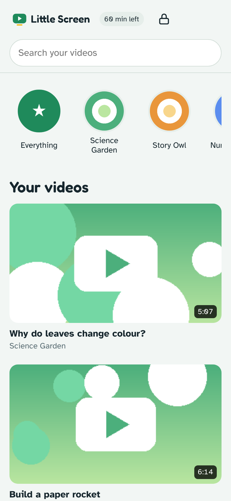
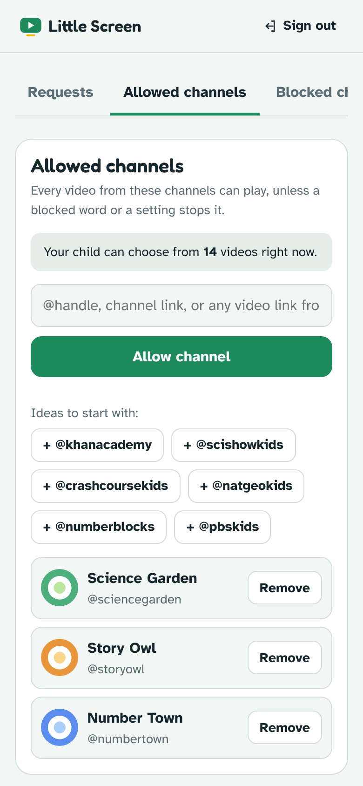
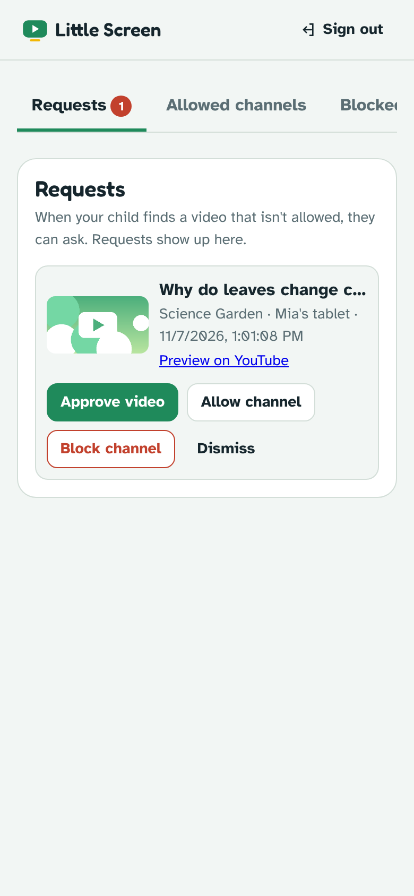

<p align="center">
  
</p>

<h1 align="center">Little Screen</h1>

<p align="center"><b>YouTube for kids, with only the channels parents choose.</b><br>
Free and open source · No ads · No tracking</p>

<p align="center">
  <a href="https://kids.springsprouts.net">Website</a> ·
  <a href="https://kids.springsprouts.net/#install">Install</a> ·
  <a href="../../releases/latest">Download for Android</a> ·
  <a href="docs/SELF-HOSTING.md">Run your own</a>
</p>

<p align="center">
  
  
  
</p>

## What it does

Little Screen is a calm video app for children. A parent picks the YouTube channels their child may watch; the child sees videos from those channels and nothing else: no endless recommendations, no surprise detours.

- **Parents choose every channel.** Allow or block channels, approve single videos, and block words.
- **"Ask a grown-up."** If a child finds a video that isn't allowed, they can ask. Parents approve it in the dashboard, or with one tap in Telegram.
- **Daily time limits** for each device, with a parent PIN to add more time on the spot.
- **Shorts off** and **"made for kids" only**, if you want.
- **One dashboard, many devices.** Manage everything from your own phone; changes reach the child's device within a minute.
- **Private by design.** No ads, no analytics, nothing collected from children. Videos play in YouTube's own player in privacy-enhanced mode.
- **Works everywhere.** Android app (APK), or install from the browser on iPhone, iPad, Windows, Mac and Chromebook.

## Install

| Device | How |
|---|---|
| **Android** | Download the APK from the [latest release](../../releases/latest) or the [website](https://kids.springsprouts.net/#install), open it, and allow the install. |
| **iPhone / iPad** | Open `https://kids.springsprouts.net/app/` in Safari → **Share** → **Add to Home Screen**. |
| **Windows / Mac / Linux** | Open the same address in Chrome or Edge → **Install app** icon in the address bar. On a Mac in Safari: **File → Add to Dock**. |
| **Chromebook** | Open it in Chrome → **Install app**. |

Then, in the [parent dashboard](https://kids.springsprouts.net/parent/), go to **Devices → Get a pairing code** and type the code on the child's device. The [website](https://kids.springsprouts.net) has a step-by-step guide for parents.

> **Tip:** Little Screen works best as the only way to watch. Remove the YouTube app and block other browsers with Screen Time (iPhone, iPad) or Family Link (Android).

## Run your own server

Schools, community groups and families can host their own copy. You need a small Node.js + PostgreSQL server (about $5–10 a month on [Railway](https://railway.com)) and a free YouTube Data API key.

**→ [Self-hosting guide](docs/SELF-HOSTING.md)**: deploy in about 20 minutes, plus optional Google sign-in, password-reset emails and Telegram alerts.

## How it works

```
 Parent dashboard ──┐                                ┌── Child app (Android, iOS, browser)
 Telegram bot ──────┼──►  Node.js server + Postgres  ◄┤      shows only allowed videos
                    │     rules · devices · requests  └── YouTube's official player (embed.html)
 YouTube Data API ◄─┘     shared channel cache
```

- **Filtering happens on the server.** A child's device only ever receives the videos it may show.
- **One shared cache.** Each channel is fetched once for every family, so the free YouTube quota covers about 600 channels.
- **YouTube's player is never modified.** No overlays and no hidden links, as the [YouTube API Services policies](https://developers.google.com/youtube/terms/developer-policies) require.

| Folder | Contents |
|---|---|
| `server/` | Express API, PostgreSQL schema, YouTube cache, Google sign-in, email, Telegram |
| `public/` | Website (`index.html`), parent dashboard (`parent/`), child app (`app/`), player page (`embed.html`), privacy and terms |
| `mobile/` | Capacitor wrapper for Android and iOS |
| `docs/` | [Self-hosting](docs/SELF-HOSTING.md), [mobile apps](docs/MOBILE.md), [maintainers](docs/MAINTAINERS.md) |

## Development

```bash
npm install
createdb littlescreen
DATABASE_URL=postgres://localhost/littlescreen YT_API_KEY=<your key> npm run dev
```

Open <http://localhost:3000>. The only runtime dependencies are `express` and `pg`. Android builds run on GitHub Actions; see [docs/MOBILE.md](docs/MOBILE.md).

## Contributing

Bug reports, ideas, translations and pull requests are welcome. Please read [CONTRIBUTING.md](CONTRIBUTING.md) and the [Code of Conduct](CODE_OF_CONDUCT.md). To report a security problem, see [SECURITY.md](SECURITY.md); please don't open a public issue.

## Privacy

Little Screen stores parents' email addresses, their rules, device names and daily watch minutes, and nothing from children. See the [privacy policy](public/privacy.html). Parents can delete their account at any time.

## License and credits

[MIT](LICENSE) © 2026 The Ananda Center of Participatory Democracy (Spring Sprouts).

Little Screen is an independent project. It isn't affiliated with or endorsed by YouTube or Google. Videos play through YouTube's embedded player under the [YouTube Terms of Service](https://www.youtube.com/t/terms).
